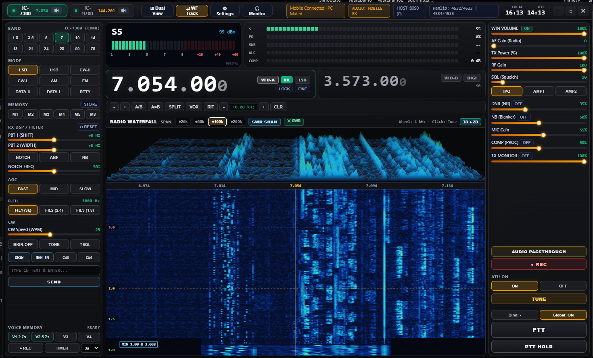
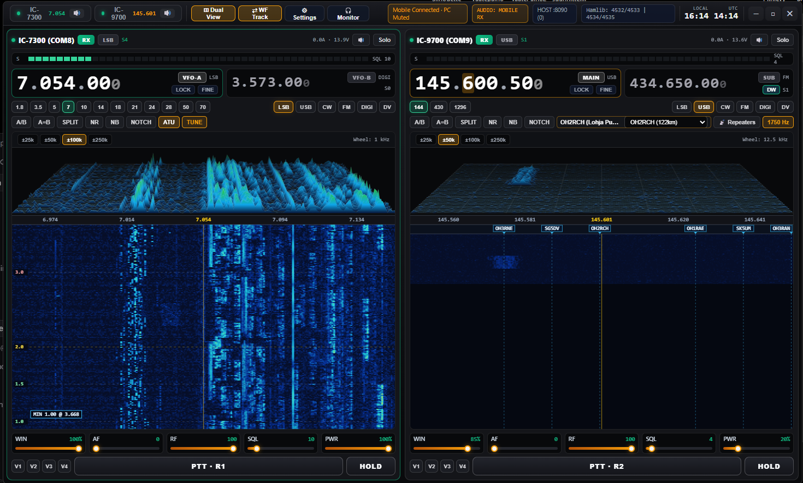
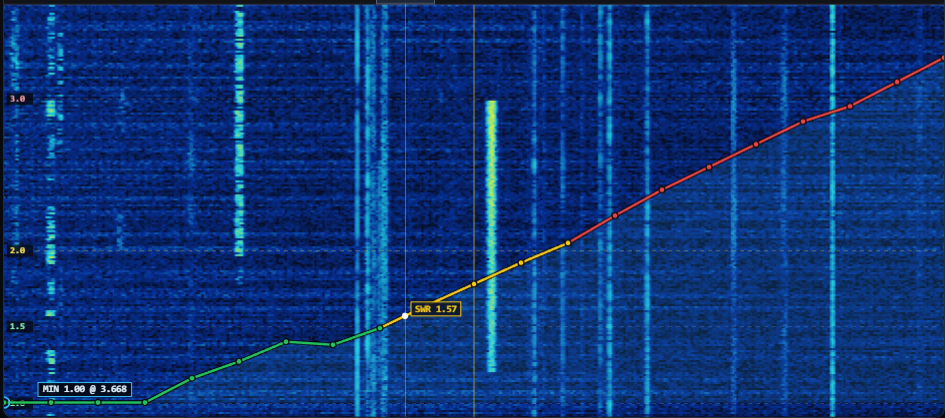
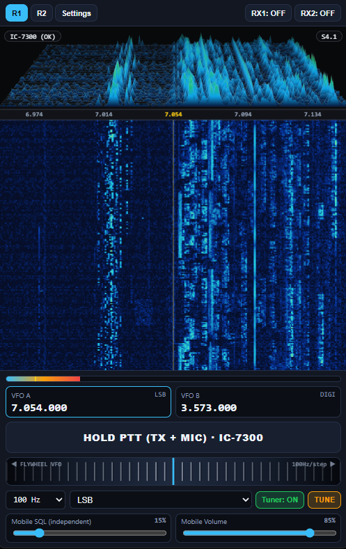

# RemoteHam — Dual-Rig Amateur Radio Remote

Desktop, Remote PC Client, Mobile HTTPS, and Hamlib `rigctld` remote control suite for **Icom CI-V** transceivers (such as IC-7300 + IC-9700) over USB/Serial with real-time 3D/2D waterfall, audio routing, CW keying, Voice Memory, SWR antenna scanning, and Windows audio passthrough.

---

## Screenshots

### Single-Radio Cockpit


### Simultaneous Dual-Radio View


---

## Key Features

### 1. Dual-Rig Control & 60 fps 3D/2D Waterfall
- Simultaneous (**Dual View**) or single-focus control of two Icom transceivers over CI-V.
- Combined **Yaesu 3DSS-style 3D spectrum** + crisp **2D waterfall** with smooth **WF Track** tuning, click-to-tune, mouse-wheel tuning, hover frequency crosshair, QRV repeater markers, and adjustable spans (`±25k` to `±250k`).
- **4 Switchable S-Meter Designs:** Click the S-meter to cycle between `ANALOG`, `CURVE`, `VU`, and `DIGITAL`.

### 2. SWR Antenna Sweep & High-SWR Warning
- **`SWR SCAN`**: Sweeps across the frequency span currently visible in the waterfall using the transceiver's active TX Power setting, plots the live color-coded SWR curve (`1.0–3.5`) directly on top of the 2D waterfall with `MIN` resonance marker & hover SWR readout, and restores the starting frequency and mode automatically.
- **High-SWR Warning**: Whenever TX SWR (or any peak) exceeds `2.5`, a centered blinking warning overlay appears over the waterfall for the duration of PTT and smoothly fades out over 5 seconds after release.



### 3. CW Keyer & Local Sidetone
- **4 Programmable CW Memory Buttons (`CW1`–`CW4`)** (right-click to edit, left-click to transmit/abort) plus a **Full-Width Live CW Text Input + `SEND`** for continuous typing.
- Automatic **±1 kHz SSB zero-beat shift** when keying CW from `LSB`/`USB`, restoring original mode and frequency afterward.
- Left-sidebar **CW Speed (WPM)** slider and clean **700 Hz Windows speaker sidetone** during live keying.

### 4. Voice Memory + Auto-Repeat Timer
- 4 recordable Voice Memory slots (`V1`–`V4`) stored as 48 kHz WAV clips with combined `● REC` / `■ STOP` button.
- **`TIMER` + `1s–10s` Interval Selector**: Automatically repeats the activated Voice Memory slot with a visible countdown until stopped via manual PTT or toggling `TIMER` off.

### 5. Audio Passthrough + RX/TX WAV Recorder
- **`AUDIO PASSTHROUGH`**: Captures Windows Default Playback audio via native WASAPI loopback and feeds it straight into Radio TX on PTT (both Host PC and Remote Client PC).
- **`Mic Ignored` / `Mic Not Ignored`** selector (so background voice chat stays off the air unless explicitly mixed) and yellow warning indicators (`Passthrough Active`) beside `PTT` and `PTT HOLD`.
- **`● REC` (QSO Recorder)**: Records combined live RX + TX audio and prompts with a Windows Save dialog when stopped.

### 6. Mobile HTTPS Web UI & Hamlib `rigctld`
- Built-in self-signed **Mobile HTTPS** web interface for phones/tablets with independent squelch gating, VFO tuning, PTT, and 1750 Hz tone burst.
- Built-in TCP **`rigctld`** servers (ports `4532`–`4535`) for WSJT-X, FT8, and contesting loggers, plus Nordic repeater lookup.



### 7. Direct GitHub Auto-Update
- Both Host and Client automatically check `jorksx/RemoteHam` on startup and in the background.
- When running the latest commit, the update button stays hidden; whenever a newer version is available on GitHub, **`⬇ Update Available`** appears in the top bar for one-click automatic update and restart (preserving local `config.json`, certificates, and recordings).

---

## Running Locally

```bat
python app.py
```

- Desktop window: `start_remote.bat` or `python app.py`
- Browser UI: `python app.py --browser`
- Headless server: `python app.py --headless`
- Remote Client mode: `python app.py --client <HOST_IP>:8090`
